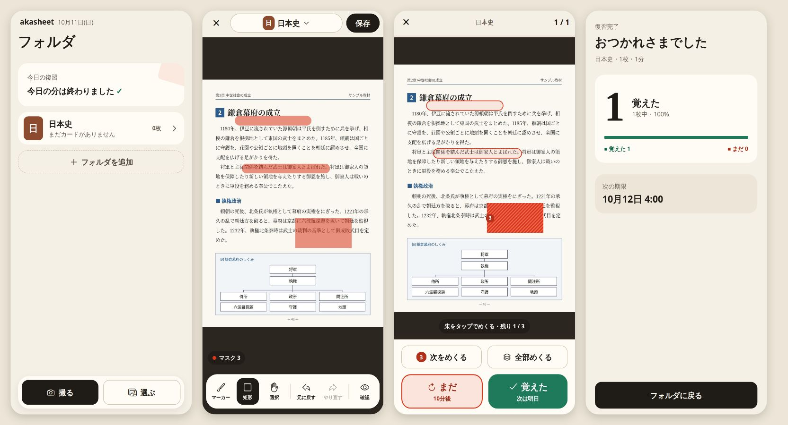
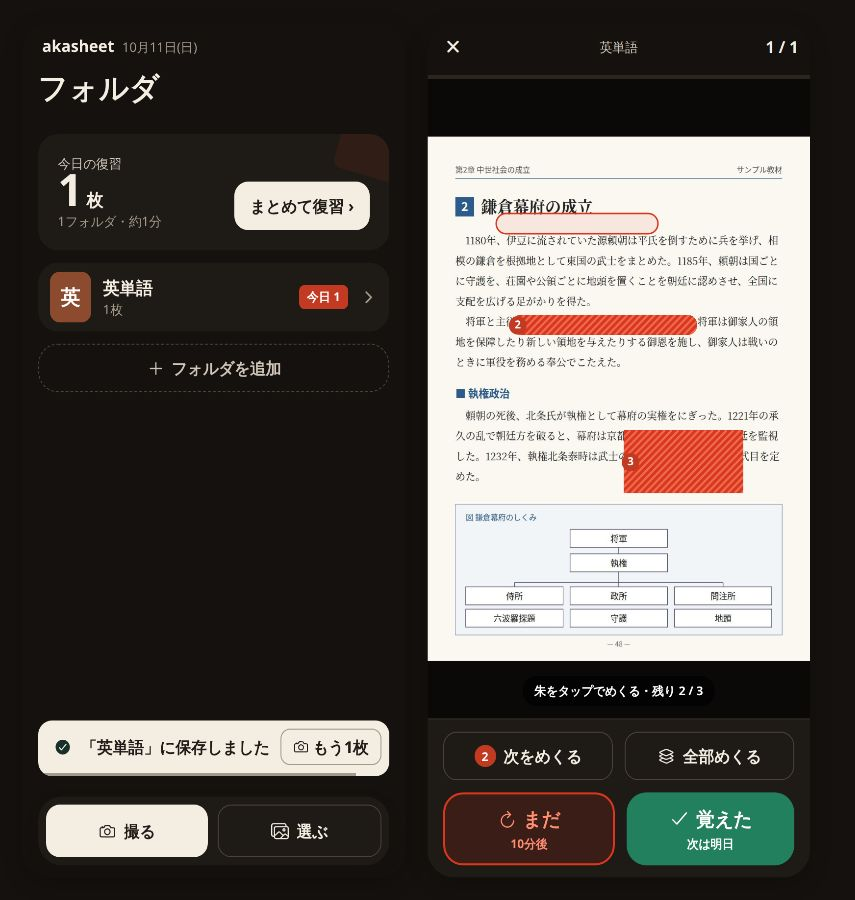

# akasheet

教科書やノートの写真を撮って、隠したいところを指でなぞるだけ。赤シートの要領で「めくって」覚える、画像暗記カードアプリです。



- **写真からカードを作る** — 撮影またはライブラリから選んだ写真に、マーカー（太さ3段階）や矩形でマスクを描きます。ピンチで拡大、取り消し・やり直しもできます。
- **赤シート方式で復習** — マスクは朱色＋斜線で隠れ、番号つき。タップで1枚ずつ、「次をめくる」で読み順に、「全部めくる」で一度にめくれます。
- **2択だけの間隔反復** — 「まだ」か「覚えた」を選ぶだけ。ボタンに次回の間隔（例: 10分後 / 次は明日）が出ます。直前の回答は5秒間取り消せます。
- **すべて端末内で完結** — アカウント不要、通信なし。データは端末の SQLite と、写真はアプリのドキュメント領域に保存します。
- **ダークモード対応** — 端末の設定に追従します。



## iPhone で試す（Expo Go）

Mac がなくても、Windows / Linux の PC と iPhone があれば動かせます。

1. 必要なもの
   - Node.js 22 以上
   - iPhone に [Expo Go](https://apps.apple.com/app/expo-go/id982107779)（Expo SDK 57 対応版）
   - PC と iPhone が同じ Wi-Fi につながっていること
2. 取得して依存関係を入れます。

   ```bash
   git clone https://github.com/<your-account>/akasheet.git
   cd akasheet
   npm install
   ```

3. 開発サーバーを起動します。

   ```bash
   npx expo start
   ```

4. ターミナルに出る QR コードを iPhone の標準カメラで読み取り、「Expo Go で開く」をタップします。
5. 初回はカメラ・写真へのアクセス許可を求められます。許可しなくても「サンプルの教科書ページで試す」から操作を体験できます。

うまくつながらないときは次を試してください。

- 社内・公衆 Wi-Fi などで端末どうしが通信できない場合は `npx expo start --tunnel` を使います。
- 「Project is incompatible with this version of Expo Go」と出る場合は、App Store で Expo Go を最新にしてください。

### 端末で動いているビルドの確認

フォルダ一覧画面の下端（撮る／選ぶドックのすぐ上、または空状態では画面下）に、**ビルド ID**（短い Git コミット SHA 7 文字とアプリ版 `v1.0.0` など）が薄いグレーで表示されます。未コミットの変更があるときは `+dirty` が付きます。

1. 表示されている SHA が、手元で期待しているコミット（`git rev-parse --short=7 HEAD`）と一致するか確認します。
2. **コミットした直後**は、ビルド ID は Metro が `app.config.js` を読み直すまで古い SHA のままです。Fast Refresh だけでは更新されないので、**開発サーバー（Metro）を一度止めて再起動**してください（キャッシュが怪しいときは `npx expo start -c`）。
3. 古いバンドル（Metro キャッシュ・古い tunnel・Expo Go の残留）を疑う場合は、次を順に試します。
   - Metro をキャッシュクリアで再起動: `npx expo start -c`
   - tunnel を使っている場合は開発サーバーを止めてから `npx expo start --tunnel` で再開
   - iPhone の Expo Go を完全終了してから QR を再読み取り
4. `.git` のない tarball などでは `unknown` と表示されます（クラッシュしません）。

## ブラウザで試す

```bash
npm run web   # http://localhost:8765
```

Web 版は動作確認と E2E テスト用です。カメラは使えないため、写真の代わりに同梱のサンプルページを使います（「サンプルの教科書ページで試す」）。

## 使い方

1. 「フォルダを作成」で科目ごとのフォルダを作ります。
2. 「撮る」「選ぶ」で写真を取り込み、覚えたい語句をマーカーでなぞるか、矩形で囲みます。
3. 「保存」すると、その日のうちに復習の対象になります。
4. 「復習をはじめる」でめくりながら答え合わせをして、「まだ」「覚えた」を選びます。

### 復習の間隔

二択版の SM-2 を使っています（純粋関数として実装し、ゴールデンベクタで検証しています）。

- 「まだ」: 10分後にもう一度出ます。覚えていたカードを忘れた場合は、易しさ（ease）が 0.2 下がります（下限 1.3）。
- 「覚えた」: 1日後、6日後、その後は「前回の間隔 × 易しさ（初期値 2.5）」日後です。上限は10年です。
- 1日の区切りは午前4時です。夜ふかししても「今日」の扱いがずれません。
- 3日以上の間隔には ±5% の揺らぎを入れて、復習日が一日に集中しないようにしています。

## 開発

| コマンド                      | 内容                                                                           |
| ----------------------------- | ------------------------------------------------------------------------------ |
| `npm start`                   | Expo 開発サーバー                                                              |
| `npm run web`                 | Web 版（ポート 8765）                                                          |
| `npm run verify`              | 秘密情報スキャン → 型チェック → ESLint → Prettier → Jest（カバレッジ閾値つき） |
| `npm test`                    | Jest（ユニットテストのみ）                                                     |
| `npm run e2e`                 | Playwright による E2E（Web 版、録画つき）                                      |
| `npm run sample`              | `assets/sample/textbook.svg` から同梱サンプル画像を書き出す                    |
| `node scripts/secret-scan.js` | 公開してはいけないファイル・文字列の検査                                       |

### 品質ゲート

- **pre-commit フック**（husky + lint-staged）: ステージしたファイルに ESLint と Prettier をかけたあと、`npm run verify` を実行します。
- **CI**（`.github/workflows/ci.yml`）: `npm run verify` と、gitleaks による全履歴の秘密情報スキャンを実行します。
- **ESLint の独自ルール**
  - `Date.now()` / `new Date()` の直接呼び出しは禁止です。時刻は `src/shared/clock.ts` の注入可能な時計から取ります。
  - `src/domain` から React / Expo / 外側の層を import することも禁止です。
- **カバレッジ閾値**: スケジューラ・マスク幾何・復習セッションに設定しています。

### E2E テスト

```bash
npx playwright install chromium   # 初回のみ
npm run e2e                       # 開発サーバーが起動していなければ自動で起動します
```

シナリオは次のとおりです。

1. フォルダを作成し、サンプルページからカードを作ります。
2. マーカー2本と矩形1つでマスクを描いて保存します。
3. 復習でマスクを1枚ずつめくり、「まだ」→「覚えた」と答えて、結果画面まで進みます。

ダークモードの画面も別のテストで撮影します。録画（webm）と各ステップのスクリーンショットは `e2e-artifacts/`（`E2E_ARTIFACTS` で変更可）に出力され、Git には含めません。日本語を正しく描画するには CJK フォント（例: Noto CJK）が必要です。

### ディレクトリ構成

```
src/
  app/         expo-router のルート（画面の入口だけを置く）
  domain/      純粋なロジック（React・Expo に依存しない）
    mask/        座標変換・線の簡略化・当たり判定・読み順・保存形式
    scheduler/   二択 SM-2・日付境界（午前4時）・揺らぎ
    review/      復習セッションの状態機械（取り消し・再出題）
  data/        SQLite（マイグレーション・リポジトリ）と画像保存
  features/    画面と、画面固有のフック・部品
  ui/          テーマ・共通部品・ダイアログ・トースト
  shared/      時計・ID 生成・エラー型
e2e/           Playwright シナリオ
scripts/       サンプル画像の書き出し・秘密情報スキャンなど
```

主な技術スタックは次のとおりです。

- Expo SDK 57、React Native 0.86、TypeScript（strict）、expo-router
- React Native Skia（描画）、Gesture Handler、Reanimated
- expo-sqlite、TanStack Query、zod

## 素材と著作権について

- 同梱のサンプルページ（`assets/sample/textbook.svg`）は、このリポジトリのために自作した SVG です。本文・図とも実在の教科書からの転載ではありません。アプリと Expo Go は SVG を直接読めないため、`npm run sample` で書き出した JPEG（`textbook.jpg`）もあわせて同梱しています。
- **実在の教科書・参考書を撮影した写真はコミットしないでください。** 多くの場合、著作権で保護されています。`npm run verify`（pre-commit と CI）では、許可した場所以外にある画像・動画をエラーにしています。
- `docs/` の画像は、上記サンプルを使った E2E テストのスクリーンショットです。

## 既知の制限

- 端末間の同期・バックアップはありません（データは端末内のみ）。
- 保存済みカードのマスクの再編集画面は未実装です（削除して作り直してください）。
- UI フォントはシステムフォントです（デザイン案の Zen 書体は同梱していません）。
- ジェスチャー処理は JS スレッドで動かしています。古い端末では、大きな画像を拡大すると描画が重くなることがあります。
- Web 版は確認用です。画像はファイルではなく、expo-sqlite のキー・バリューストアにデータ URI として保存します。

## ライセンス

[MIT](LICENSE)
